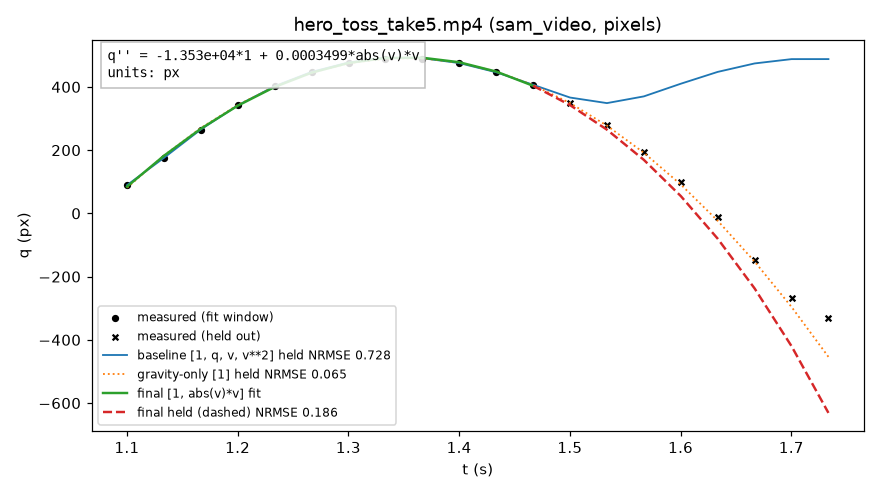

# Pixel Physicist

Film a moving object with a phone. SAM 3.1 tracks it, Muse Spark acts as the
scientist: it reads the residual evidence, diagnoses why the first model fails,
proposes the missing physics, and the system validates the result by predicting
motion it never saw.

## How it works

```
phone clip
  → tracking (SAM 3.1 video, HSV color fallback)
  → calibration to coordinates: 1-DOF q(t), or projectile x(t), y(t)
  → classical fit of a default physical model (weak-form init + shooting)
  → Spark loop: read residual plots, propose the missing term, refit
  → held-out prediction, scored by NRMSE + BIC over a fixed horizon
```

The numeric fitting is classical. Spark's contribution is proposing and
revising model *structure* from residual evidence; an ablation with a negative
control measures exactly that contribution. The pipeline handles one object
and one static camera, in two scientist modes:

- **1-DOF mode** — a single coordinate `q(t)` (vertical toss, pendulum
  displacement) with terms in `q, v`; Spark looks for terms like quadratic
  drag `abs(v)*v` or Coulomb friction `sign(v)` outside the baseline
  `[1, q, v, v**2]`.
- **Projectile mode** — two coupled coordinates `x(t), y(t)` with terms in
  `x, y, vx, vy`; Spark looks for drag coupled through the speed, e.g.
  `sqrt(vx**2+vy**2)*vx`, with the same coefficient expected on both axes.

## Current state (Day 5 done: ablation collected, G5 RED)

Built and verified:

- Tracking: SAM 3.1 video and an HSV color fallback; synthetic clips with
  known ground truth in both modes (`tests/fixtures/`).
- Fitting: weak-form (integral) initialization plus shooting refinement;
  every candidate is scored on held-out motion it never saw
  (`results/baseline.json`, reproduced by `scripts/run_baseline.py`).
  Synthetic truth is recovered exactly in both modes; the baseline fails
  visibly on the real hero clip (held-out NRMSE 0.73 vs gravity-only 0.065
  — the simple control is reported, not hidden).
- Scientist: the 3-tool Spark loop (`fit_model`, `plot_residuals`,
  `submit_model` with a beat-the-baseline guard) is built in both modes
  and both 5-run synthetic gates are green (G4/G4b 5/5, `results/day4.json`
  via `scripts/run_day4.py`): the hidden drag coefficients are recovered
  exactly. After an audit noted the gate runs fit the menu answer before
  inspecting any residual, the loop now attaches the baseline residual
  plots up front so the first fit diagnoses seen evidence
  (`results/day4_diag.json`, 1 verification run per mode).
- Ablation: 12 runs (3 baselines + 9 Spark loops at `low` effort, all from
  tracked observations) via `scripts/run_ablation.py` — see the table
  below. G5 is RED: the hero claim holds, the negative control and the
  exact-term recovery do not.

Not built yet: the demo video. (Shipped since: the one-command
`pixelphys run …` wiring, the report and ghost-overlay renderer, the
equation graph, and the replay renderer.)

## Ablation (Day 5, `results/ablation.csv`)

Split protocol throughout: fit the first 60%, score the next 2 s
(min(2 s, clean tail)) by continuing each model's own fitted trajectory.
B = baseline + Spark (3 repeats, `reasoning_effort="low"`); A = baseline.
Mean B vs A; "beat" = lower held-out NRMSE.

| Clip | A held-NRMSE | B held-NRMSE (mean of 3) | Beats A | Terms found | Cost |
|---|---|---|---|---|---|
| H hero (tossed ball, 20 pts) | 0.732 | 0.399 (0.490 / 0.187 / 0.519) | 3/3 | r1 `1,q,abs(v)*v`, r2 `1,abs(v)*v`, r3 `1,q,v,sign(v)` | ~$0.045 |
| N negative control (pendulum, 215 pts) | 0.041 | 0.037 (0.037 / 0.037 / 0.037) | 3/3 (worse: see below) | spurious `v**3` + `sign(v)` every repeat; r1/r2 are unsubmitted fallbacks† | ~$0.098 |
| S synthetic tracked (30 pts) | 0.062 | 0.005 (0.004 / 0.008 / 0.004) | 3/3 | true `abs(v)*v` 1/3; `q*v` distractor 2/3 | ~$0.074 |

Total: ablation $0.22 for 9 Spark runs (Day-5 tuning pilots ≈ $0.18
separately; cost-log total ≈ $0.99 Spark + ~$0.19 SAM video (957 billed
frames @ $0.20/1k, estimated from local frame counts), day-4 gates
included, of $150). Gate:
H GREEN (3/3 beat, −46% mean), N RED (Spark adds terms in 3/3; 10.6%
mean gap, outside the 5% band), S RED on exact recovery (1/3), GREEN on
beating the baseline (3/3, −91% mean).

† N r1/r2 never called `submit_model`; the loop reported its best-held
model as an unsubmitted fallback. They enter the gate mean as condition-B
outcomes, not as Spark endorsements.

## Ablation v2 (audit B, `results/ablation_v2.csv`)

Same frozen conditions, stricter loop: screen-then-tight fits (15 s loop
budget, 5 s screens, shared memo, 8 fit-call cap), submit guard v2
(≥2% held-NRMSE **and** BIC **and** train-within-5%), repeats H:3 N:5
S:5. 13 repeats in ~10 min (≈ $0.44; S-r1 close 00:16:45 → files close 00:23:03). G5 RED stands; v2 is a separate
experiment reported side by side.

| Clip | A held-NRMSE | B held-NRMSE | Beats A | Terms found | Verdict |
|---|---|---|---|---|---|
| H hero | 0.732 | 0.551 (0.187 / 0.732 / 0.732) | 1/3 | drag once (fallback); baseline submitted 2/3 | RED (need 2) |
| N control | 0.041 | 0.040 (3× baseline, 0.037, 0.037) | 2/5 | baseline 3/5; `v**3`, `q**2` once each | GREEN (gap 4.3%, clean 3/5) |
| S synthetic | 0.062 | 0.041 (2× 0.008 drag, 3× 0.062 baseline) | 2/5 | true drag 2/5 as fallback; baseline submitted 3/5; **no** `q*v` submissions | RED (need 3 submitted-correct; 0/5) |

What v2 teaches (all numbers from committed transcripts):
- The guard cleans the control: no `v**3`/`sign(v)` submissions; the one
  accepted extra term (`q**2`, N r5) passes all three checks narrowly
  (held 0.0366, BIC 642.5 < 645.8, train +0.6%).
- The train rule is miscalibrated: the overfit baseline owns the fit
  window, so true sparse models lose on train (S drag 0.117 vs 0.102,
  +15%; H drag 3.40 vs 1.17) and can never pass v2. BIC already prices
  complexity; the follow-up is held-NRMSE **and** BIC, dropping train.
- Strictness has a price: 2/5 S runs recover the true drag but as
  fallbacks (Spark explored instead of submitting), which the
  pre-registered rule does not count — same non-submission habit as v1.
- Transfer (`results/transfer.json`, `scripts/transfer_check.py`,
  `rollout_score` on held-out clips): true drag transfers (0.008 → 0.003
  vs baseline 0.443 on a second toss), the `q*v` distractor does not
  (0.004 → 0.349 vs 0.443), the N spurious term is inconclusive on take 2
  (0.075 vs the baseline's 0.088 — both degrade ~2× on the harder take),
  and the v2 `q**2` find does not beat the baseline in transfer
  (0.090 vs 0.088). BIC + transfer agree on S; held-NRMSE alone does not.

**Limits.**
- The numeric fitting is classical; Spark proposes model *structure* only.
- The hero result is narrow: the drag term beats the *baseline* 4× on
  20-point arcs, yet still loses to plain gravity on real data — so no
  drag-on-real-arcs claim is made. Discovery is proven on synthetic truth
  (exact recovery 5/5), not on phone footage.
- The negative control is not clean: Spark sometimes adds small spurious
  terms that shave ~10% off held error while fitting train and BIC worse.
  Treat extra terms with suspicion unless BIC and transfer agree.
- On noisy tracked (vs clean truth-array) synthetic, exact-term recovery
  degrades: a correlated distractor can out-predict the true term on one
  realization (BIC still prefers the truth).
- Scope: one object, one static camera, short clips. Numbers behind every
  claim above are in `results/` with the scripts that produced them.

## Seeing the equation (report visual)

The main output of a run is a single graph, not a table of numbers.
On the same axes it shows the measured trajectory as points, the baseline
model's curve, the gravity-only control curve, and the final model's curve
continued (dashed) into motion the fit never saw — with the discovered
equation, its fitted coefficients, and every model's held-out NRMSE
written on the graph itself. If the final curve peels away from the
held-out points, the graph says so; that is the validation, not a
decoration.



*Hero toss take5: baseline held-NRMSE 0.73, gravity-only 0.065, discovered
drag 0.19. The third curve is the point — plain gravity still wins on
this short arc, so no drag-on-real-arcs claim is made.*

## One-go projectile replay

A finished throw clip goes in (`pixelphys run throw.mp4 --prompt "ball"
--mode projectile`); out come the fitted projectile equations,
the equation graph, a report, and a replay video in which a rendered ball
re-flies the *fitted* equations — never the tracked points. It is the same
pipeline in two coupled coordinates with the same held-out validation,
plus an offline renderer. Built-in limits: a batch post-capture flow
(tens of seconds, not realtime); a monocular clip determines the throw
plane only, so every replay is labelled "fitted model" with no depth
claim; and where drag is not identifiable the report says gravity-only.

## Quickstart

```sh
uv venv
source .venv/bin/activate
uv pip install -e ".[dev]"
cp .env.example .env   # fill in MODEL_API_KEY (same key serves LLMs + SAM 3.1)
pixelphys run --help
pytest -q
```

On a slow connection, install packages smallest-first (`meta-sam-parser`,
`numpy`, …) rather than one bulk install. Scripts that need no API key run
with `PYTHONPATH=src python3`.
