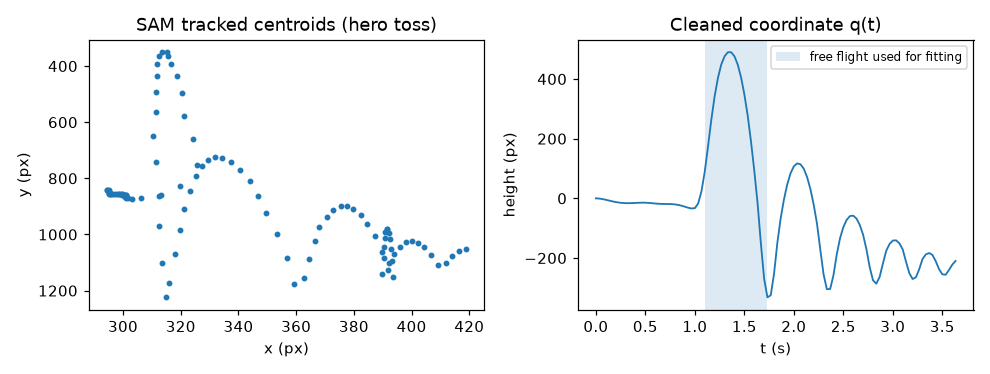
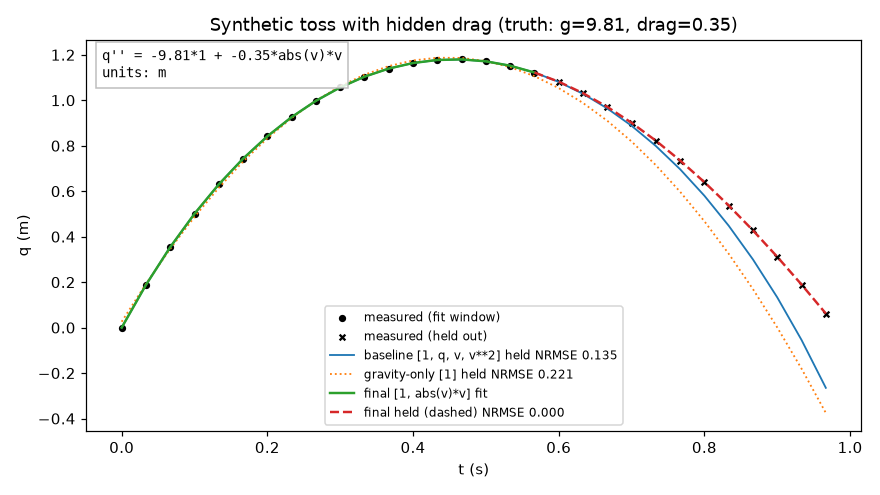
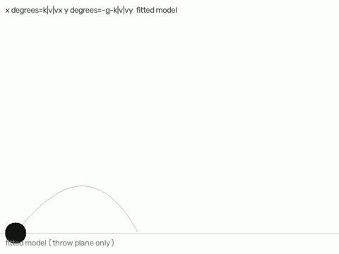
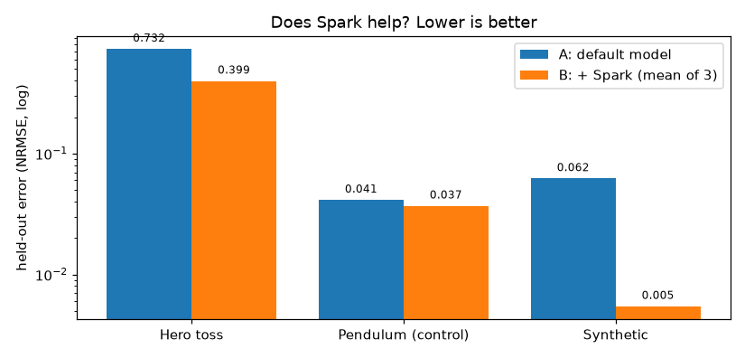

# Pixel Physicist

*Built for the Meta Global AI Developer Hackathon (Push the Frontier track).*

## The problem

Drop a ball, toss a tennis ball, let a spring bounce — the motion follows a
simple mathematical rule (an equation). Normally, finding that rule from a
video takes a human with measuring tools, spreadsheets, and time.

**Can a computer watch a short phone video and figure out the rule by
itself — then prove it got the right rule by predicting motion it has
never seen?**

That is what this project does.

## The solution, in plain words

1. **Watch.** You give the program a short video of one moving object.
   Meta's **SAM 3.1** model finds the object in every frame and follows it,
   turning the video into a list of positions over time. (If SAM can't find
   it, two built-in backup trackers try instead.)
2. **Try the obvious explanation first.** The program fits a simple
   "textbook" equation to the first part of the motion.
3. **Check where it goes wrong.** It then predicts the rest of the motion —
   the part it wasn't allowed to fit — and draws where the prediction
   drifts away from reality.
4. **Ask the scientist.** Meta's **Muse Spark** model looks at those
   error pictures, works out what physics is missing ("the error grows
   with speed — that looks like air resistance"), and suggests a better
   equation.
5. **Prove it.** The new equation is only accepted if it predicts the
   unseen part of the motion better than the simple one did. Guessing
   doesn't count; the held-back footage is the judge.

The heavy maths (actually fitting numbers) is done by ordinary classical
code. Spark's job is the creative step a spreadsheet can't do: deciding
*what kind of physics* is missing.

## See it work

**Step 1–2: SAM follows the ball, and the video becomes a clean curve.**



**Step 3–5: the discovered equation, drawn against reality.** The dashed
part is motion the fit never saw. The equation is written on the graph
itself, with the score for each model:



On this made-up test clip (where we know the true answer), the program
recovers the hidden air-resistance value almost exactly.


On the real phone clip above, notice the third curve: plain gravity with
no air resistance at all still wins on this very short throw. We show that
on purpose — the program reports the simple explanation whenever it is
actually better. More on honesty below.

**The equation, played back.** Once an equation is found, the program can
re-run it in a little simulated world (this replay is driven by the fitted
equation, not by the original video frames):



## Four kinds of motion it understands

| You film… | What it looks for | Example result |
|---|---|---|
| Something tossed up and down | Air resistance that grows with speed | Found it exactly on the test clip |
| A ball thrown across the frame | Air resistance acting in both directions at once | Found it on the test clip |
| A spring bouncing | A spring that gets stiffer the more it stretches | Found it on the test clip |
| A ball rolling up and down a slope | Rolling friction (the kind that always slows you down, whichever way you roll) | Found it on the test clip |

The same system was also tried on **other people's footage** (a public
physics-video dataset). It worked end-to-end there too — and correctly
concluded that one clip was explained by plain gravity, no extra physics
needed.

## Does the "scientist" step actually help? (the honest results)

We ran a careful comparison: the simple model alone vs the simple model +
Spark, three tries each, on three clips. Lower error is better:



- **Hero toss (real phone video):** Spark's equations beat the simple
  model all 3 times (error 0.73 → 0.40 on average). ✅
- **Pendulum (the "nothing new here" test):** the simple model was
  already right, but Spark kept inventing small extra effects that
  looked good by luck. ❌ — this failure is real and we report it.
- **Made-up test clip:** Spark beat the simple model all 3 times, but
  picked the exact right equation only 1 time in 3 — a look-alike
  equation can fit one throw almost as well. When we tested its pick on
  a *second* throw, the wrong pick fell apart and the right one held.
  That second-throw test is now part of how we judge results.

Full numbers, including a second stricter version of the experiment:
[docs/results.md](docs/results.md).

## What it cannot do (yet)

- One object, a still camera, and a short clip. No moving cameras, no
  crowds of objects.
- Very short or very noisy throws may not contain enough information to
  tell similar effects apart — then it says so instead of guessing.
- One long, complicated real spring video (30 s) defeated the fitting
  maths. Short clips work; that one didn't.
- It is not live: analysing a clip takes tens of seconds after filming,
  because the video model works on finished clips, not streams.

## Try it

```sh
uv venv
source .venv/bin/activate
uv pip install -e ".[dev]"
cp .env.example .env   # fill in MODEL_API_KEY (one key serves both Meta models)
pytest -q              # 110 checks, no API key needed
```

Then, with a key in `.env`:

```sh
pixelphys run your_throw.mp4 --prompt "tennis ball" --trim
pixelphys run throw.mp4 --prompt "ball" --mode projectile
pixelphys run spring.mp4 --prompt "weight" --mode spring --tracker motion
pixelphys run slope.mp4 --prompt "ball" --mode rolling --tracker motion
```

Each run leaves a folder in `runs/` with the full picture (the equation
graph), a video with the prediction drawn over your footage, a report
page, and the found equation saved as data.

## Learn more (the technical docs)

- [docs/modes.md](docs/modes.md) — the four motion modes, what each one
  looks for, and how to pick the right one for your clip.
- [docs/maths.md](docs/maths.md) — how the fitting works: why we don't
  just measure speed from the video, the integral trick that makes it
  robust, and how "held-out prediction" scoring keeps everyone honest.
- [docs/architecture.md](docs/architecture.md) — how the program is put
  together, which Meta model does what, and what everything costs.
- [docs/results.md](docs/results.md) — every experiment and number,
  including the failures, and what they do and don't prove.
- [docs/demo_script.md](docs/demo_script.md) — the 90-second demo
  storyboard (recorded from saved runs, never a live call).

## Credits

Built solo during the Meta Global AI Developer Hackathon (Oct–Nov 2026)
on two Meta models: **SAM 3.1** (the eyes) and **Muse Spark** (the
scientist). The fitting is classical code; no model was trained.
Third-party test footage used in development is from the Morpheus
real-world physics dataset (MIT licence); demo footage is self-filmed.
